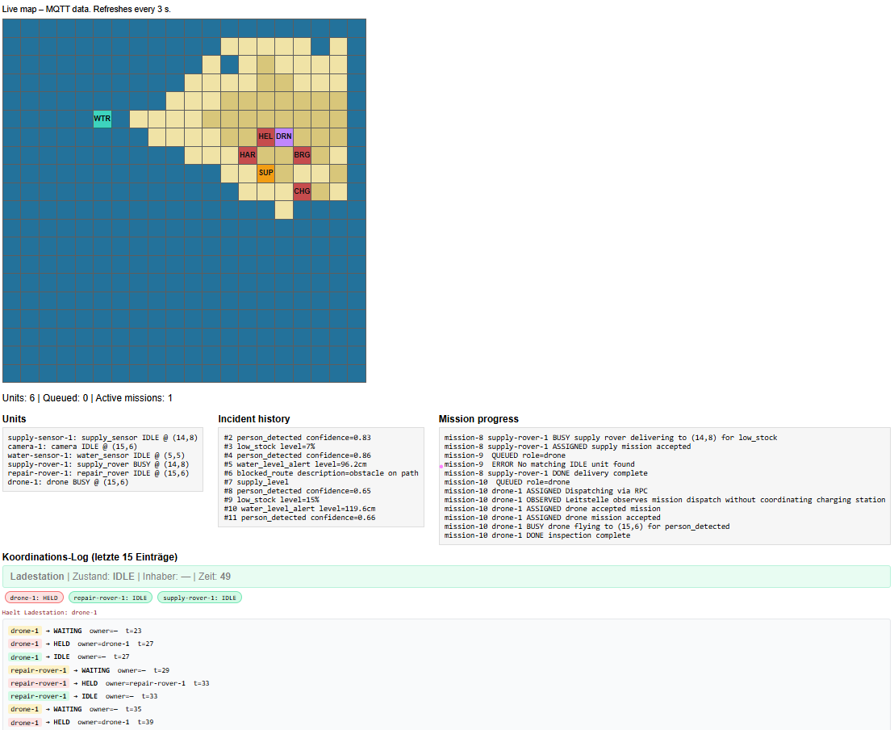

# Sturmflut Nordsee

[](https://github.com/loatsoat/Sturmflut/actions/workflows/ci.yml)

A distributed disaster-management system for a fictional North Sea island after a storm surge. Cameras and sensors detect incidents, a central control room (the *Leitstelle*) assigns missions, and a drone and two rovers carry them out. The vehicles coordinate access to a shared charging station without a central lock.

Course project for **Verteilte Systeme** (Distributed Systems), SS2026.
Authors: Ho Quang Minh Phan, Bao Chau Nguyen.

Everything is simulated (no real hardware) and runs as separate Docker containers.



## What it demonstrates

| Task | Topic | Where to look |
|---|---|---|
| 1 | REST over raw TCP sockets, no HTTP framework | `leitstelle/app.py`, `leitstelle/dashboard.py` |
| 2 | RPC (gRPC) for assigning missions to vehicles | `leitstelle/proto/assignment.proto`, `sensoren/sim_*.py` |
| 3 | MQTT messaging with QoS, duplicate and stale message handling | `sensoren/mqtt_utils.py`, `mosquitto/` |
| 4 | Distributed mutual exclusion with Ricart/Agrawala and Lamport clocks | `sensoren/coordination.py` |

## Architecture

```
 cameras / sensors ──MQTT──►  Mosquitto  ◄──MQTT── vehicles (telemetry, missions)
        │                         │                       ▲
        └──────HTTP POST──────────┼───────────►  Leitstelle ──gRPC──┘
                                  │             (REST + dashboard)
                                  └── vehicles ◄──MQTT──► vehicles
                                      (Ricart/Agrawala for the charging station)
```

### Containers

| Service | Script | Role |
|---|---|---|
| `mqtt-broker` | Eclipse Mosquitto 2.0 | Message broker, port 1883 |
| `leitstelle` | `app.py` | REST server, map, incident queue, mission assignment, dashboard (host port **8081**) |
| `sensor-camera` | `sim_camera.py` | Reports `blocked_route` and `person_detected` incidents |
| `sensor-water-level` | `sim_water_sensor.py` | Reports water level |
| `sensor-stock` | `sim_supply_sensor.py` | Reports supply level, raises `low_stock` |
| `sensor-drone` | `sim_drone.py` | Drone, can fly over water (gRPC port 50051) |
| `sensor-water` | `sim_repair_rover.py` | Repair rover, land only (gRPC port 50052) |
| `sensor-supply` | `sim_supply_rover.py` | Supply rover, land only (gRPC port 50053) |

### Incident to vehicle mapping

| Incident type | Assigned role |
|---|---|
| `person_detected` | Drone |
| `blocked_route`, `structure_damage` | Repair rover |
| `low_stock`, `material_request` | Supply rover |

Vehicle states: `IDLE`, `ASSIGNED`, `BUSY`, `ERROR`.

## Getting started

### Prerequisites
- Docker and Docker Compose
- Python 3.11 (only needed to run the tools and tests locally)

### Run
```bash
git clone https://github.com/loatsoat/Sturmflut.git
cd Sturmflut
docker compose up -d --build
```

Open the dashboard at <http://127.0.0.1:8081/>.

Stop everything:
```bash
docker compose down
```

View logs:
```bash
docker compose logs -f leitstelle
```

## REST API

The Leitstelle implements HTTP on raw TCP sockets. Unsupported methods get `405 Method Not Allowed`.

| Method | Path | Description |
|---|---|---|
| GET | `/` | HTML dashboard (map, units, logs, coordination panel) |
| GET | `/map` | Island map (20x20 grid, water/sand, infrastructure) |
| GET | `/status` | Units, incidents and missions |
| GET | `/history` | Processed incidents |
| POST | `/unit` | Register a unit |
| POST | `/incident` | Report an incident |
| POST | `/mission_update` | Mission progress reported by a vehicle |

Trigger a test incident:
```bash
python tools/trigger_incident.py person_detected 12 8 1
# usage: trigger_incident.py <type> <x> <y> [priority]
```

or with curl:
```bash
curl -X POST http://127.0.0.1:8081/incident \
  -H "Content-Type: application/json" \
  -d '{"type":"blocked_route","x":12,"y":8,"priority":1}'
```

## MQTT topics

| Topic | QoS | Publisher | Purpose |
|---|---|---|---|
| `sensors/events/<unit_id>` | 1 | Cameras, sensors | Incident events (JSON) |
| `vehicles/telemetry/<unit_id>` | 0 | Vehicles | Position and state |
| `vehicles/missions/<unit_id>` | 1 | Vehicles | Mission status updates |
| `vehicles/coordination/requests/<resource>` | 1 | Vehicles | Ricart/Agrawala REQUEST |
| `vehicles/coordination/replies/<resource>` | 1 | Vehicles | Ricart/Agrawala REPLY |
| `vehicles/coordination/releases/<resource>` | 1 | Vehicles | Ricart/Agrawala RELEASE |
| `vehicles/coordination/state/<resource>` | 1 | Vehicles | State feed, observed by the Leitstelle only |
| `charging/trigger/<unit_id>` | 1 | Tools | Makes a vehicle request the charging station |

The Leitstelle ignores duplicate incidents (same type and position) and outdated mission messages.

## Ricart/Agrawala (charging station)

The drone, repair rover and supply rover compete for one charging station. Each vehicle broadcasts a timestamped REQUEST (Lamport clock) and may enter the critical section only after all peers have replied. A vehicle that is itself waiting with a smaller timestamp, or that currently holds the resource, defers its reply until it releases. The Leitstelle only observes and does not grant access.

Why MQTT for this: every vehicle is already connected to the broker, one publish reaches all peers, and QoS 1 duplicates are made harmless because replies are tracked in a set.

## Design decisions

- **Three protocols, each for what it is good at.** MQTT for events and telemetry (many publishers, fire-and-forget, the Leitstelle does not need to know who is online). gRPC for mission assignment (a typed request to one specific vehicle that needs an answer). HTTP for registration and as a fallback.
- **HTTP on raw sockets.** Task 1 asks for no framework, so request parsing and status codes are written by hand in `leitstelle/app.py`.
- **At-least-once delivery, made idempotent.** MQTT QoS 1 can deliver twice, so the Leitstelle drops duplicate incidents (same type and position) and outdated mission updates instead of trying to get exactly-once delivery.
- **No central lock for the charging station.** Ricart/Agrawala runs between the vehicles over MQTT. The Leitstelle only observes the state topic, so it is not a single point of failure for coordination.
- **Size-based channel choice.** `CommunicationRouter` sends payloads over MQTT and switches to HTTP above 12 KB, or when no broker client is available.
- **Retries instead of start order.** Containers retry broker connection and registration, so `docker compose up` works without health-check ordering.

## Tests

```bash
pip install pytest -r sensoren/requirements.txt
pytest
```

CI runs the same commands on every push (`.github/workflows/ci.yml`).

- `tests/test_verification_plan.py` runs the Ricart/Agrawala verification (safety and liveness) against a simulated broker.
- `tests/test_communication_router.py` tests the routing between MQTT and HTTP.

Helper scripts in `tools/`:
- `verify_ricart.py` runs a 3-vehicle Ricart/Agrawala demo.
- `verify_dup_test.py` checks duplicate message handling.
- `trigger_incident.py` posts a test incident.

Manual test protocols with expected and actual results are in [`docs/Testdokumentation.md`](docs/Testdokumentation.md), and the requirements analysis is in [`docs/requirements.md`](docs/requirements.md) (both in German).

## Project structure

```
Sturmflut/
├── docker-compose.yml
├── map.json                  # 20x20 island map
├── mosquitto/                # broker config
├── leitstelle/               # control room: REST server, dashboard, gRPC client
│   ├── app.py
│   ├── dashboard.py
│   └── proto/assignment.proto
├── sensoren/                 # simulated sensors and vehicles
│   ├── sim_*.py
│   ├── coordination.py       # Ricart/Agrawala
│   ├── communication_router.py
│   └── mqtt_utils.py
├── tests/
├── tools/
└── docs/
```

## License

MIT, see [LICENSE](LICENSE).
